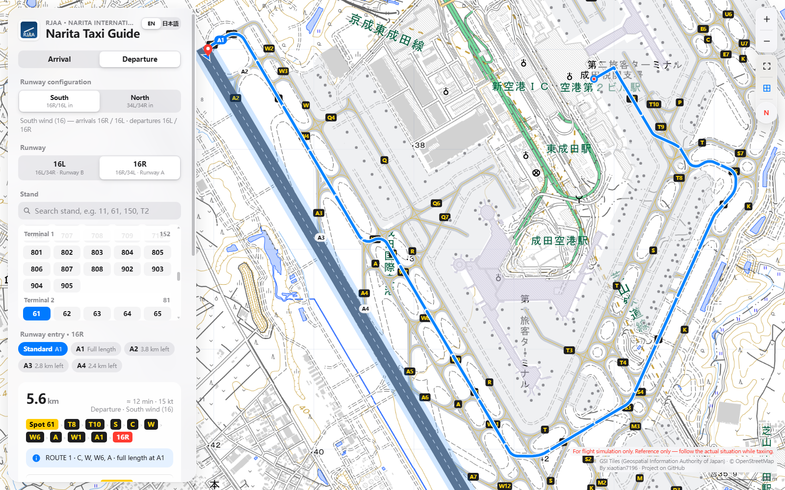
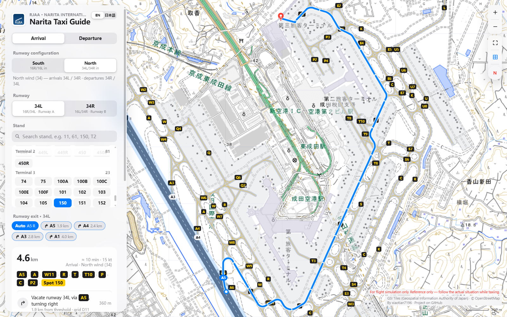
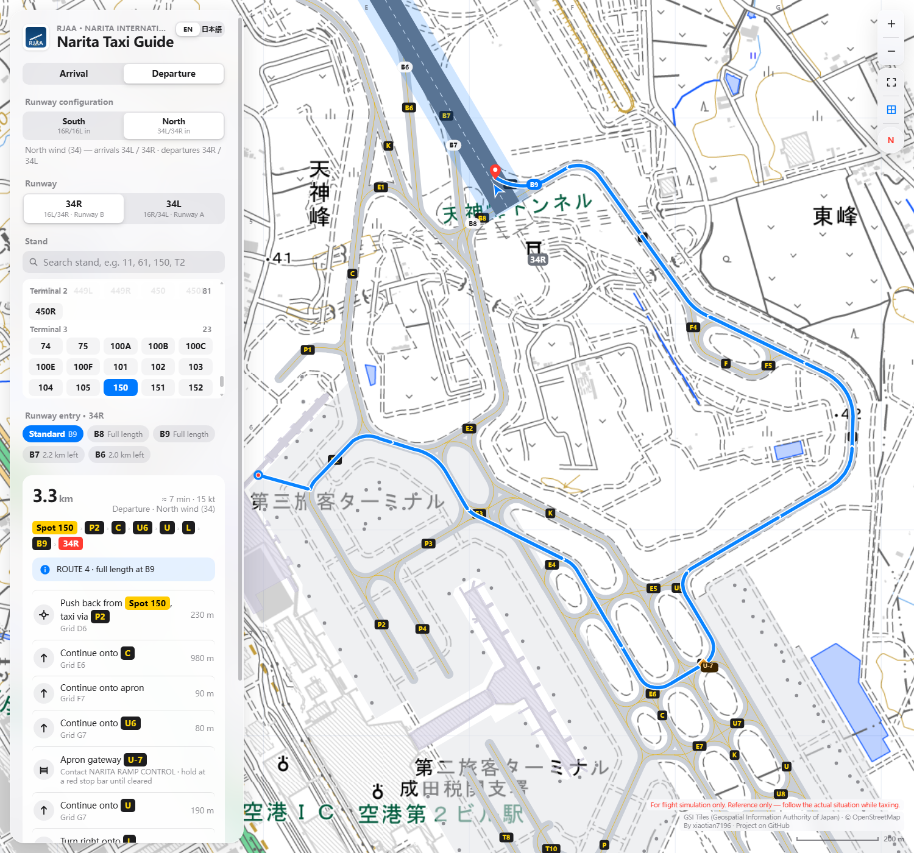

# Narita Taxi Guide (RJAA)

An Apple-style, full-screen taxi route guide for Tokyo Narita (RJAA), built for flight
simulation. Pick a runway configuration, a runway, a stand and (optionally) a runway exit or
entry point, and the guide draws the standard taxi route on a gridded airport map with
turn-by-turn steps.

The UI is available in **English** and **Japanese** (switch in the panel header).

> For flight simulation only. Not for real-world navigation. ATC instructions always take precedence.

This is the Narita edition of the [Haneda Taxi Guide (RJTT)](https://github.com/xiaotian7196/Haneda_taxi_route_manual):
the map, router and UI are the same technique, rebuilt on Narita's dataset and published
taxi logic.







## Features

- **Arrival mode** – runway exit → stand. Exits are detected from the taxiway network, labelled with
  turn side (L/R) and distance from the threshold, and can be picked from the list or on the map.
  "Auto" prefers the AIP's designated speedy turn-offs.
- **Departure mode** – stand → runway holding point, with the published entry (A1, A10, B1, B9) as default.
- **Runway configurations** – South wind (16R/16L) and North wind (34L/34R).
- **Published taxi logic** – the four AIP Japan standard departure routes (ROUTE 1–4), the arrival
  flow from the AIP Taxiing Charts, and the designated turn-off taxiways.
- **Gateway routing** – every route is required to pass one of the `GWY` apron gateways; the step list and the
  map mark the point where the aircraft leaves the outer taxiway system for the apron, with the Ramp Control /
  stop-bar reminder. A stand whose gateway cannot be connected falls back to the natural path and says so.
- **Runway crossings** are flagged on the map and in the step list.
- **Chart grid** – 500 m cells (columns A–Z without I/O, rows 1–n) with edge rulers; every step and stand shows its grid reference.
- **GSI background map** – the pale map or aerial photo from GSI Tiles (Geospatial Information Authority of Japan), or no background. Switch with the layers button.
- Full-screen map with pan, wheel/pinch zoom, taxiway signs, hover highlighting, light/dark mode and a mobile bottom sheet.

## Getting started

Requirements: Node.js 22.6+ (scripts run TypeScript directly).

```bash
pnpm install
pnpm dev
```

If pnpm reports that `node` is not recognised (a standalone pnpm install does not ship a Node
runtime for lifecycle scripts), install one once with `pnpm runtime set node 22 -g` (pnpm 12+) or
install Node.js 22 LTS, then reopen the terminal.

All data the app needs is already in the repository, so no X-Plane install is required to run it.
`pnpm build` produces a static site in `dist/`. `pnpm test` routes every flow / runway / terminal
combination as a smoke test, and `pnpm test:all` sweeps every stand on every runway.

### Refreshing the data

```bash
pnpm fetch:osm      # newer OSM geometry
pnpm build:data     # regenerate src/data/rjaa.json
```

The runway records come from AIP Japan; to update them, edit `data/navdata/RJAA.dat` (see below).

## Data

| Source | File | Used for | Licence |
| --- | --- | --- | --- |
| AIP Japan, RJAA AD 2.12 (JCAB, effective 2 Oct 2025) | `data/navdata/RJAA.dat` | Runway thresholds and runway ends | JCAB AIP terms |
| OpenStreetMap via Overpass | `data/osm-rjaa.json` | Taxiways, stands, aprons, terminals, runway ends | © OpenStreetMap contributors, ODbL |
| [GSI Tiles](https://maps.gsi.go.jp/development/ichiran.html) (`pale`, `seamlessphoto`) | loaded at runtime | Background map | Geospatial Information Authority of Japan (attribution shown on the map) |

`data/navdata/RJAA.dat` is the same `RWY:` record format X-Plane uses in `CIFP/*.dat`, so the
project can also be refreshed from an X-Plane 12 `Custom Data` folder without touching the rest
of the pipeline. Narita has no displaced thresholds: LDA equals TORA on all four runway ends.

## How routing works

1. Taxiway ways become an undirected graph. Stands connect to it through their OSM lead-in lines (or
   the nearest taxiway segment).
2. Runway centerlines come from the AIP thresholds. Taxiway nodes within 14 m of a centerline are runway
   nodes. That gives exits and entries, and lets the router penalise crossings and forbid back-taxi on the active runway.
3. Each published route is a list of taxiways (`src/procedures.ts`). The router (`src/router.ts`) runs
   Dijkstra over `(directed edge, progress, gateway-passed)` states. Edges on the current or next listed
   taxiway cost 1×, unnamed apron lines cost 1.35×, and any other taxiway costs 2.4×. So the path follows
   the published flow and still connects through short links; finishing the route without a listed taxiway
   costs 4 km, and one taxiway of the list may be skipped at a fixed cost instead of detouring just to
   touch it. The gateway bit makes an apron `GWY` node mandatory: a goal reached without passing one is
   rejected, which is what forces the aircraft through Ramp Control instead of cutting into the apron.
   Because the state is the edge just travelled, turns sharper than 105° are not allowed at a junction
   (metre-long junction stubs are exempt, their direction is noise). Every degree of turning costs a
   little, and so does every change of taxiway name, so gentle curves can't add up to a loop and the
   path doesn't weave between parallel taxiways. Arrivals must also enter the stand lead-in line in the
   direction of travel, and the turn out of it is charged on departure; departures must reach the runway
   along the chosen entry taxiway.
   The finished path is then inspected for the two detours a taxi clearance never contains: a closed
   excursion that leaves a junction and comes back to it, and a reversal that sweeps round a long fillet.
   When one is found, the search is repeated with those edges excluded, so the result is the shortest
   path that still makes sense to taxi. A published taxiway that cannot be reached without such a detour
   is left out and reported as missed rather than driven around.
4. Exits and entries are traced back to their true turn-off point, where the taxiway leaves the runway
   pavement rather than where it happens to touch the centerline — a shallow connector would otherwise
   be pulled hundreds of metres down the runway and onto its neighbour's junction. An exit must leave at
   100° or less to the landing direction. An entry must not need more than a 105° turn onto the runway
   (140° within 300 m of the runway end). When an exit or entry is picked by hand, published-route options
   that come out more than 35% longer than the best one are dropped.
5. The path is grouped into steps by taxiway name, with turn direction and runway-crossing callouts.

## Narita taxi logic

### The movement model

Narita does not turn from a main taxiway straight into a stand. Every ground movement runs through
an apron gateway:

```
Runway  →  outer taxiway system (A side / B side)  →  Gateway (GWY)  →  apron taxilane  →  stand
```

The gateways are the `GWY` holding positions on the AIP Taxiing Charts (and in the OSM extract);
inside them NARITA RAMP CONTROL (121.6 / 121.75 / 118.15) clears the aircraft, and a red apron stop
bar means stop and wait for that clearance. The guide makes the gateway a **mandatory waypoint**:
the router carries a "gateway passed" state and only accepts a path that goes through one of these
nodes. An arrival takes the first `GWY` after the runway (the apron entry), a departure the last one
before the runway (the apron exit). It first checks the gateway the natural taxi would already pass
and only reroutes to a nearby alternative when the path avoids every gateway. The gateway is drawn as
an amber `G` diamond and inserted into the step list, so the boundary between the movement area and
the apron is visible rather than implied.

### Arrivals

| Runway | After vacating |
| --- | --- |
| 16R (A) | A-side network, flowing toward the Terminal 2/3 side and the aprons there |
| 16L (B) | B-side network (K, E, S, T, D, N, M, W …) toward Terminal 1/2 south and the cargo area |
| 34L (A) | A-side network toward the matching gateway and apron |
| 34R (B) | B-side network toward Terminal 1/2, the south apron and cargo |

The "B side" is the network worked by runway B, not the literal B taxiway: the B6/B7 exits join K,
E, S and T directly, while the B taxiway itself runs along the north-west perimeter. Under north
wind the aircraft typically vacates at the north end and crosses the central area to reach the
terminal, which is why the central junctions (C, S, E, K) need extra care.

### Departures

| Runway | Route system |
| --- | --- |
| 16R | A-side network to the 16R entry |
| 16L | B-side network to the 16L entry |
| 34L | A-side network to the 34L entry |
| 34R | B-side network to the 34R entry (K/U/L → B9) |

Departures are not simply arrivals reversed: the named routes leave through fixed gateways and the
central connectors (K, E, B, A, S, T, W) decide which way the aircraft joins the runway parallel
taxiway.

### Published departure routes

Departures use the four routes named in **AIP Japan RJAA AD 2.22 (V)**, which ATC assigns by name:

| Route | To | Routing via |
| --- | --- | --- |
| ROUTE 1 | RWY 16R | K, S6, C, W, W6 and A |
| ROUTE 2 | RWY 34L | C, S7, K and A |
| ROUTE 3 | RWY 16L | A, K, S6, C and B |
| ROUTE 4 | RWY 34R | A, S, C, S7 and K |

The named route starts at the apron gateway; Ramp Control assigns the movement from the stand to
that gateway. The guide therefore constrains the runway-parallel taxiway (A for 16R/34L, B for
16L/34R) for every stand, and applies the published middle section where the whole terminal can fly
it — `C → W → W6 → A` from Terminal 2/3 on ROUTE 1, `C → S7 → K → A` from Terminal 3 on ROUTE 2,
and `C → B` on ROUTE 3. Stands that cannot join that section without a detour fall back to the
shortest path and show which published taxiways were left out.

Arrivals are not named in the AIP. The Taxiing Charts (`RJAA AD 2.20`) show the flow from the
runway to the apron gateways, and the guide follows it up the runway-parallel taxiway before
routing to the stand.

The AIP's designated speedy turn-offs are used for the "Auto" exit:

| Runway | Exit (distance from threshold) |
| --- | --- |
| 16R | A6 (1 800 m), A7 (2 250 m) |
| 34L | A5 (1 800 m), A4 (2 250 m) |
| 16L | B6 (1 860 m), B7 (2 100 m) |
| 34R | B4 (1 740 m), B2 (2 030 m) |

Full-length entries are A1 (16R), A10 (34L), B1 (16L) and B9 (34R). Intersection departures remain
available from the entry chips (e.g. A2 on 16R).

## Project layout

```
index.html            app shell
src/main.ts           UI state and panel rendering
src/map.ts            SVG map, grid, pan/zoom
src/router.ts         template-constrained Dijkstra and turn-by-turn steps
src/plan.ts           selection → routed options
src/procedures.ts     published taxi routes per runway / terminal
src/airport.ts        graph model, runway exits and entries
src/i18n.ts           English / Japanese strings
scripts/              OSM fetch, data build, route smoke tests
data/navdata/         runway records from AIP Japan
data/osm-rjaa.json    OSM aeroway extract
public/RJAA.png       app icon
```

## Licence

Copyright (C) 2026 xiaotian7196.

This project is free software, released under the **GNU General Public License, version 2**
(SPDX: `GPL-2.0-only`). You may copy, modify and redistribute it under the terms of that licence; the
full text is in [LICENSE](LICENSE).

It is distributed in the hope that it will be useful, but **without any warranty**, without even the
implied warranty of merchantability or fitness for a particular purpose. See the GNU General Public
License for details.

The licence covers the guide's own source code. Bundled third-party data keeps its own terms — see the
Data table above: the OpenStreetMap extract is © OpenStreetMap contributors under the ODbL, and the
runway data comes from AIP Japan (JCAB).

## Credits

Technique, map, router and UI after the
[Haneda Taxi Guide](https://github.com/xiaotian7196/Haneda_taxi_route_manual) by
[lpxlpx7](https://github.com/lpxlpx7) and [xiaotian7196](https://github.com/xiaotian7196).
Narita dataset, taxi logic and this edition by xiaotian7196.

Taxi logic follows AIP Japan RJAA AD 2.20 (Taxiing Charts) and AD 2.22 (V) (Standard Taxiing
Routes), effective 2 October 2025. ATC instructions always take precedence.
